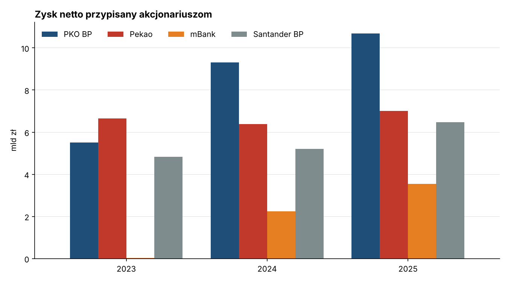
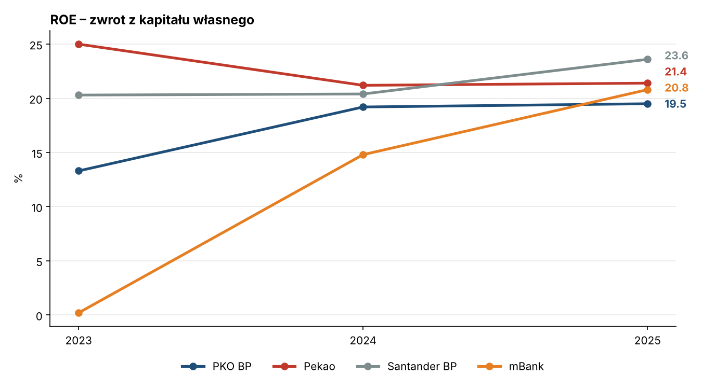
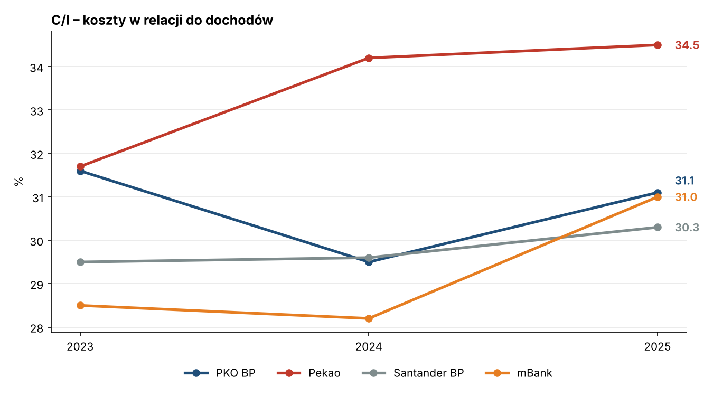
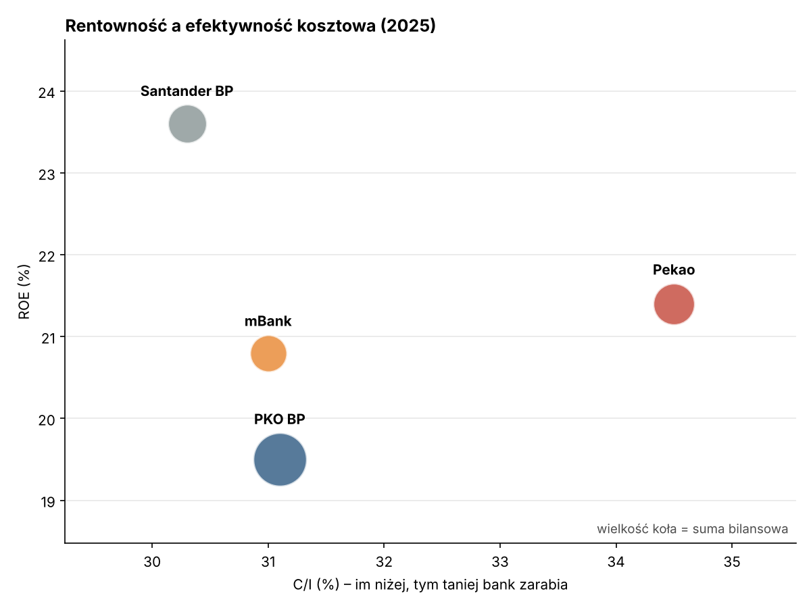

# Analiza finansowa banków z GPW (2023–2025)

Porównanie rentowności i efektywności czterech największych banków notowanych na Giełdzie Papierów Wartościowych w Warszawie: **PKO BP, Pekao, mBanku i Santander Bank Polska**. Projekt pokazuje, jak zmieniały się ich wyniki w latach 2023–2025 i który bank najlepiej łączy wysoki zwrot z kapitału z niskimi kosztami.

Dane pochodzą z raportów rocznych, prezentacji wynikowych i komunikatów giełdowych banków (lista źródeł na dole). Analiza jest w Pythonie (pandas, matplotlib).

## Najważniejsze wnioski

1. **Santander BP był w 2025 r. najbardziej rentowny.** Miał najwyższe ROE (23,6%) i najniższy wskaźnik C/I (30,3%), czyli zarabiał najwięcej na kapitale akcjonariuszy przy najniższych kosztach.
2. **PKO BP zarabia najwięcej w złotówkach, ale nie najwięcej na kapitale.** 10,7 mld zł zysku netto to więcej niż Pekao i mBank razem. Przez rezerwy na sprawy frankowe (ok. 4,4 mld zł w 2025 r.) ROE wyniosło jednak tylko 19,5%, najmniej w grupie.
3. **mBank przeszedł największą zmianę.** W 2023 r. koszty ryzyka prawnego kredytów frankowych (ok. 4,9 mld zł) niemal wyzerowały zysk (ROE 0,2%). W 2025 r. ROE wynosiło już 20,8%, a zysk był rekordowy. Gdy problem kredytów CHF wygasa, widać, ile bank naprawdę zarabia.
4. **Pekao ma najdroższy model działania.** Ma najwyższe C/I w grupie (34,5% w 2025 r., wzrost z 31,7% w 2023 r.). Mimo to ROE na poziomie 21,4% to druga pozycja, bo bank nie był obciążony kosztami frankowymi tak jak konkurenci.
5. **Rentowność sektora się wyrównała.** W 2023 r. ROE czterech banków mieściło się w przedziale 0–25%, a w 2025 r. już tylko 19,5–23,6%. Wpływ wysokich stóp procentowych i kosztów frankowych na różnice między bankami słabnie.

## Podsumowanie za 2025 r.

| Bank | Zysk netto (mln zł) | Aktywa (mld zł) | ROE | ROA* | C/I | Zysk r/r |
|---|---:|---:|---:|---:|---:|---:|
| Santander BP | 6 479 | 308,0 | 23,6% | 2,1% | 30,3% | +24,3% |
| Pekao | 7 015 | 352,2 | 21,4% | 2,0% | 34,5% | +10,0% |
| mBank | 3 544 | 280,2 | 20,8% | 1,3% | 31,0% | +58,0% |
| PKO BP | 10 682 | 583,1 | 19,5% | 1,8% | 31,1% | +14,8% |

\* ROA policzone w skrypcie na aktywach z końca roku (patrz „Ograniczenia”).

## Wykresy









## Co oznaczają wskaźniki

- **ROE (Return on Equity)**: zysk netto w relacji do kapitału własnego. Mówi, ile bank zarabia na każdych 100 zł powierzonych przez akcjonariuszy. Najważniejsza miara rentowności banku.
- **ROA (Return on Assets)**: zysk netto w relacji do sumy bilansowej. Pokazuje rentowność całego majątku, niezależnie od tego, jak bardzo bank korzysta z dźwigni.
- **C/I (Cost/Income)**: koszty działania w relacji do dochodów. Im niższy, tym efektywniej bank zarabia. W Polsce wskaźnik ok. 30% uchodzi za bardzo dobry.

## Struktura projektu

```
analiza-finansowa/
├── data/banki_gpw.csv   # dane wejściowe ze źródłem dla każdego wiersza
├── analiza.py           # obliczenia, tabela podsumowująca i wykresy
├── wykresy/             # wygenerowane wykresy PNG
└── requirements.txt
```

## Jak uruchomić

```bash
pip install -r requirements.txt
python analiza.py
```

Skrypt wypisze tabelę podsumowującą i zapisze wykresy do folderu `wykresy/`. Żeby dodać kolejny rok albo bank, wystarczy dopisać wiersze do `data/banki_gpw.csv`.

## Ograniczenia

- **ROE i C/I to wartości raportowane przez banki**, a każdy bank liczy je trochę inaczej, np. Pekao wlicza do kosztów składkę na Bankowy Fundusz Gwarancyjny. Porównanie jest orientacyjne.
- **ROA liczone na aktywach z końca roku**, a nie na średnich, więc może się nieznacznie różnić od raportowanego przez banki.
- **Dane Santander BP za 2025 r. są wstępne (niezaudytowane)**, a wartości za 2023–2024 pochodzą z raportu za 2024 r. i nie uwzględniają późniejszych przekształceń danych porównawczych. Suma bilansowa za 2025 r. jest podana w zaokrągleniu do mld zł, tak jak w prezentacji banku. W 2025 r. ogłoszono przejęcie większościowego pakietu akcji banku przez austriacką Erste Group.
- **C/I mBanku za 2025 r. (31%) i suma bilansowa PKO BP za 2023 r. są podane w zaokrągleniu**, tak jak w źródłach.
- Zysk netto oznacza zysk przypisany akcjonariuszom jednostki dominującej (dane skonsolidowane grup kapitałowych).

## Źródła

- PKO BP: [prezentacja wyników za 2023 r.](https://www.pkobp.pl/media_files/ebed09b7-eea1-4aee-a54f-ec12133ca448.pdf), [wyniki za 2024 r. (bank.pl)](https://bank.pl/w-calym-2024-roku-zysk-netto-grupy-pko-bp-byl-o-691-proc-wyzszy-r-r/), [wyniki za 2025 r. (Parkiet)](https://www.parkiet.com/wyniki-spolek/art43952591-pko-bp-mial-10-682-mln-zl-zysku-netto), [raport roczny 2025](https://www.pkobp.pl/relacje-inwestorskie/wyniki-finansowe/raport-roczny-2025)
- Pekao: [Raport Zintegrowany 2025 – wybrane dane finansowe](https://raport-pekao.pl/en//the-bank-and-the-pekao-group-in-2025/selected-financial-data-and-indicators/)
- mBank: [prezentacja wyników za 4Q 2024](https://www.mbank.pl/pdf/msp-korporacje/relacje-inwestorskie/wyniki-finansowe/2024/presentation-q4-pol.pdf), [wyniki za 2025 r. (Parkiet)](https://www.parkiet.com/banki/art43779831-prezes-mbanku-bijemy-rekordy-i-idziemy-po-wiecej), [suma bilansowa 2025 (Parkiet)](https://www.parkiet.com/wyniki-spolek/art43778271-grupa-mbanku-zakonczyla-2025-rok-z-rekordowymi-wynikami)
- Santander BP: [wyniki za 2024 r. (ISBnews)](https://inwestycje.pl/gielda/santander-bp-mial-5-21273-mln-zl-zysku-netto-204-roe-w-2024/), [wstępne wyniki za 2025 r. – prezentacja](https://pap-mediaroom.pl/sites/default/files/attachments/202602/DOC.20260204.53445337.zal01_SBP_Preliminary_results_presentation_2025_2026-02-04.pdf)

---

Projekt edukacyjny. Nie stanowi rekomendacji inwestycyjnej.
